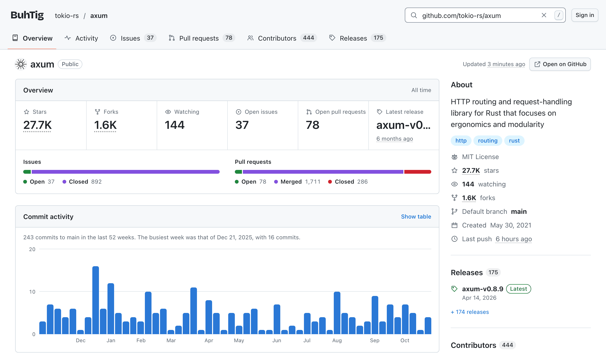
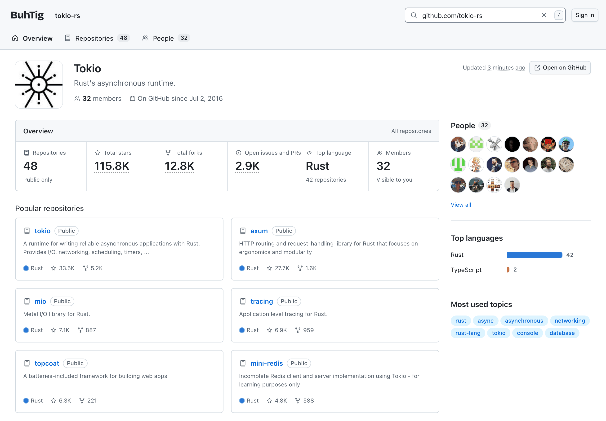
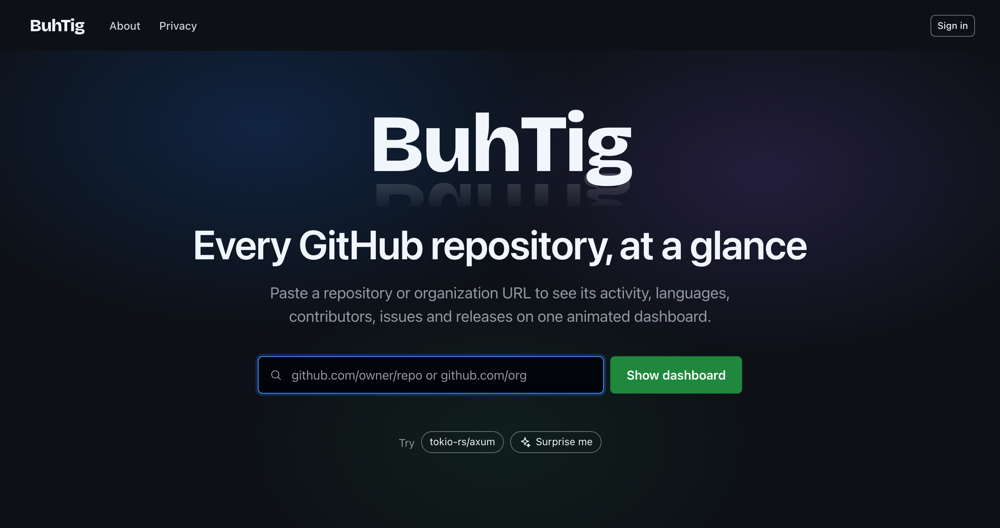

# BuhTig

BuhTig turns a GitHub repository, organization or user URL into an animated dashboard,
puts two of them side by side at `/-/compare/{a}...{b}`, and draws a card of each to embed
at `/-/preview/{name}.svg`. Repository lists and charts' tables download as CSV files, made
in the browser from what the page shows, with when the data was fetched. On any page, `Ctrl+K` (`⌘K` on a Mac) opens a command palette
that finds dashboards as you type, and `owner/repo pulls` opens a dashboard's tab. It is one
application plus one PostgreSQL database, configured by one file, for github.com or a GitHub
Enterprise Server. What it must do is in [SRS.md](SRS.md).

- `src/BuhTig`: the server (Rust). It serves the UI, talks to GitHub and PostgreSQL. It
  draws cards as PNG in Noto Sans, under the SIL Open Font License (`src/BuhTig/fonts/OFL.txt`),
  cut to Latin, Greek and Cyrillic.
- `src/BuhTig.Angular`: the UI (Angular). It is built into the server, not deployed on
  its own. It looks like GitHub, after its open-source Primer design system, and sets its
  wordmark in Bricolage Grotesque, under the SIL Open Font License (`public/fonts/OFL.txt`).

## Screenshots

On real GitHub data. Like BuhTig, the dashboards follow your light or dark theme.

A repository's dashboard, of [tokio-rs/axum](https://github.com/tokio-rs/axum):

<picture>
  <source media="(prefers-color-scheme: dark)" srcset="docs/screenshots/repository-dark.png">
  
</picture>

An organization's dashboard, of [tokio-rs](https://github.com/tokio-rs):

<picture>
  <source media="(prefers-color-scheme: dark)" srcset="docs/screenshots/organization-dark.png">
  
</picture>

The home page, as a visitor sees it:



## Build

```sh
cd src/BuhTig.Angular && npm ci && npm run build
cd ../BuhTig && cargo build --release
```

Build the UI first: a release build embeds it, so `src/BuhTig/target/release/BuhTig` is
the only file to deploy. Cargo warns if the UI has not been built. `npm run build` also
compresses the UI's files, which BuhTig serves compressed, and fails if the home page would
transfer more than its 300 KB budget.

## Run locally

You need PostgreSQL 15 or newer and a config file. BuhTig creates its database on first
start if it does not exist yet, which needs a role allowed to create databases
(`CREATEDB`); otherwise, create an empty one yourself with `createdb buhtig`.

```sh
cd src/BuhTig
cp config.example.toml config.toml && chmod 600 config.toml
```

In `config.toml`, set:

- `server.public_url = "http://localhost:8080"`
- `database.url` for your database
- `github.client_id` and `github.client_secret` of a GitHub OAuth app whose callback URL
  is `http://localhost:8080/-/auth/callback`
- `security.encryption_key`, from `openssl rand -base64 32`

Then run `cargo run` and open <http://localhost:8080>. BuhTig creates its tables on the
first start. Nothing else needs setting up.

Debug builds read the UI from `src/BuhTig.Angular/dist` as they serve it. Run
`npm run watch` in `src/BuhTig.Angular` and reload the page to see UI changes.

## Test

- `cargo test` in `src/BuhTig`. The tests start their own PostgreSQL cluster from the
  PostgreSQL 15+ binaries on `PATH` (or `pg_config --bindir`). They never call GitHub:
  tests that need it get a stand-in, `github::stub` (NFR-MNT-03). The only test that calls
  the real GitHub is `#[ignore]`d:
  `cargo test reads_a_public_repository_from_github -- --ignored` runs it.
- `npm test` and `npm run test:scripts` in `src/BuhTig.Angular`.
- **On each release,** add its database to `src/BuhTig/tests/fixtures/schemas`, as the
  README there says, so that the next release is tested upgrading from it.
- **Load test:** `cargo test --release load_test -- --ignored --nocapture` in
  `src/BuhTig`, after building the UI. 100 users at once, half of them signed in, open the
  home page and dashboards served from the cache, with 10,000 users registered. BuhTig
  runs on one worker thread, as on one vCPU. It fails if any answer takes longer than
  300 ms at the 95th percentile, or the process uses more than 1 GB. It takes a few
  minutes, and only a release build says anything about speed.

## Operate

- **Config:** BuhTig reads only its config file, `./config.toml` or the path given with
  `--config`. Restart it after changing the file. `config.example.toml` lists every key and
  its default.
- **TLS:** terminate HTTPS in front of BuhTig, for example in a reverse proxy. BuhTig
  itself listens on plain HTTP at `server.listen`.
- **Compression:** BuhTig compresses what it sends. It serves the UI's files compressed
  with brotli or gzip, as the browser accepts, and gzips other responses of 1 KB or more,
  so the proxy needn't compress anything. The proxy should pass `Accept-Encoding` on, send
  compressed responses as they are, and keep `Vary` if it caches. BuhTig speaks HTTP/1.1,
  over which browsers open at most 6 connections to a host, and a dashboard asks for about
  10 things at once, and a comparison of two repositories about 16, so have the proxy
  speak HTTP/2 to browsers.
- **GitHub:** BuhTig only reads from GitHub, through `api.github.com` over HTTPS, and
  signs users in through `github.com`, unless `github.host` names a GitHub Enterprise
  Server (below). It checks GitHub's certificate against the root certificates built into
  it, not the host's.
  Requests go through `github.proxy_url` if it is set, and never through a proxy named in
  the environment, so a proxy that inspects TLS does not work. Visitors' requests carry
  the OAuth app's client ID and secret, which earn a higher rate limit than anonymous
  requests. GitHub ignores a client ID it does not know, so check `github.client_id` if
  visitors run into the rate limit soon. Repository dashboards also count issues and pull
  requests with GitHub's search API, which has a separate, much lower rate limit: up to
  five searches per repository per `cache.ttl` (open, merged and closed pull requests,
  closed issues, and the pull requests updated last, for merge velocity). The Issues and
  Pull requests tabs list theirs with the search API too, one search per page of 25 shown,
  each cached apart for `cache.ttl` in the viewer's scope, and never the pages before it.
  GitHub's search reaches only the first 1,000 that match, so the lists have at most 40
  pages, and say so. A comparison of
  two repositories searches for the open pull requests and those updated last of each as
  it loads. When it runs out, the stat cards, the issues and pull requests widget and
  merge velocity show cached figures, or an error until it resets. GitHub
  computes a repository's commit activity when it is first asked for, so its chart may say
  "Calculating on GitHub…" for up to a minute while BuhTig asks again. GitHub does not list
  the contributors of its very largest repositories, and their dashboards say so.
- **GitHub Enterprise Server:** set `github.host` to the server's host name, such as
  `github.example.com`, and register the OAuth app on that server. BuhTig then reads from its
  API at `https://{github.host}/api/v3`, signs users in there, takes URLs on that host alone
  in its search box, links to that server's pages, and shows avatars from it. Set
  `github.api_url` too if the API is elsewhere, as on GitHub Enterprise Cloud with data
  residency, `https://api.{subdomain}.ghe.com`. The server's certificate must chain to a
  public root certificate authority, as BuhTig trusts no other. GitHub's user IDs and names
  mean something on one host alone, so a database keeps the host it was first used with:
  BuhTig refuses to start with another, and a database from before `github.host` existed
  is github.com's. Use a new database to move to another host.
- **Sign-in:** users sign in with their GitHub account. GitHub asks them to let BuhTig
  identify them, and grants it nothing more: no private repositories or organization data,
  and nothing to write. Open BuhTig at `server.public_url`, since a sign-in started at
  another address cannot finish. When `access.allowed_users` lists logins, only those
  users may sign in, and anyone else sees a "not allowed" page. A session ends after
  `auth.session_idle_timeout` without use, `auth.session_max_age` after sign-in, or when
  the user signs out. A user is signed out everywhere once GitHub rejects their sign-in, as
  when they revoke BuhTig's access on GitHub, and everyone is signed out when
  `security.encryption_key` changes. BuhTig sets two cookies: the session's, and one that
  keeps a sign-in's state for 10 minutes. Both are `Secure`, unless `server.public_url` is
  `http://localhost`. Each client may have 10 sign-ins checked with GitHub a minute; past
  that, BuhTig asks them to wait a minute.
- **Personal access tokens:** a signed-in user may save one personal access token in
  Settings, so that their dashboards include the private repositories and organization
  data it can see, and their own dashboard their private repositories. No one needs one. BuhTig asks GitHub about each token before it saves
  it, and saves it only if it is valid and belongs to the signed-in user. Each client may
  have 10 tokens checked a minute. Tokens are stored encrypted with
  `security.encryption_key`, and are never shown or logged. When the key changes, users are
  signed out and asked to enter their tokens again. A token that GitHub stops accepting,
  as when it is revoked or expires, is marked invalid: the user's requests go with their
  sign-in again, and BuhTig asks them to replace the token. Replacing or removing a token
  deletes the data cached with it, and what was observed with it, at once.
- **Shortcuts:** for signed-in users, BuhTig remembers the last 20 dashboards they opened,
  only which ones and when, and lets them pin up to 12 with the Pin button in a dashboard's
  header. Their home page lists up to 12 of them beside the search box, pins first. In
  Settings, users can reorder or unpin their pins and clear their history. Housekeeping
  trims each user's history to 20 entries.
- **Watchlists:** a signed-in user may keep up to 10 named watchlists, of up to 25
  repositories each, of any owners, at `/-/watchlists`, which the avatar menu links to.
  They add repositories by name or URL, from their pins, or with "Add to watchlist…" in a
  repository dashboard's header, and may reorder or remove them, and rename or delete a
  watchlist. A watchlist keeps the repositories' names alone, so adding one asks GitHub
  nothing. Its overview shows each repository in a row: its latest release, its last push,
  its commits over the last 26 weeks, and its latest workflow run on its default branch, with
  when each was fetched. Each row is read as the repository's dashboard is, with the user's
  own credentials and cache, so one they may not see says "Not found or private" and nothing
  more, and none keeps the others from loading. A row is read once it comes into view, 4 at
  a time, and costs at most 4 requests to GitHub per `cache.ttl`: the repository, its latest
  release, one page of its workflow runs and its commit activity, each conditional and cached
  with its dashboard's, so a repository whose dashboard was opened lately costs nothing. A
  watchlist has no refresh of its own: refreshing a repository's dashboard refreshes its row.
- **Recently viewed:** the signed-in home page lists up to 8 public repositories whose
  dashboards were opened on this instance lately, and the visitor's home page suggests the
  first 3 to try. They come from the shared cache alone, never from data fetched with a
  personal access token, and BuhTig asks GitHub nothing for them. The Privacy page says so.
- **Deleting data:** in Settings, once they confirm, signed-in users can delete everything
  BuhTig keeps of theirs: their account, sessions, credentials, the data cached and the
  figures observed with their token, their history, their pins and their watchlists. This signs them out on every browser. BuhTig stays
  among their authorized OAuth apps on GitHub until they revoke it there, which Settings
  links to, since BuhTig changes nothing on GitHub.
- **Access:** in public mode, the default, anyone may open the home page and the
  dashboards of public repositories, organizations and users, with public data only. Settings,
  shortcuts, watchlists and refreshing a dashboard need sign-in. With `access.mode = "private"`,
  every page needs sign-in but the sign-in page, the About and Privacy pages and
  `/-/health`: a visitor is sent to sign in, and then back to the page they opened. In
  either mode, private and internal repositories and private organization data are shown
  only to users whose personal access token can see them on GitHub. GitHub says "not
  found" both of what does not exist and of what the viewer may not see, so BuhTig shows
  one "Not found or private" page, which tells the viewer what they can do: sign in, or
  add a token. Someone who loses access on GitHub loses it in BuhTig once their cached
  copy is `cache.ttl` old and GitHub answers again. A signed-in user may refresh a
  dashboard once a minute, so that it asks GitHub at once.
- **Organizations:** an organization's dashboard reads up to `limits.org_repositories` of
  its repositories, those pushed to most recently, 100 per request to GitHub. A larger
  organization's figures cover only those, and its dashboard says so. Its members widget
  shows only members who make their membership public. GitHub doesn't report how many
  there are, so for an organization with more than 24, BuhTig makes one more request to
  count them. Its Repositories tab shows each repository's commits over the last 26 weeks
  as a sparkline, which costs one request to GitHub per repository, cached as the
  repository's own dashboard's commit activity is. BuhTig asks for a sparkline only once
  its row comes into view, so a page of 25 repositories costs at most 25 requests per
  `cache.ttl`, and a visitor's sparklines count as one load of the organization's
  dashboard. A repository's contributors and releases past one page are counted with one
  more request each.
- **Users:** a user's dashboard shows their profile and, as an organization's does, up to
  `limits.org_repositories` of the repositories they own, with the same table, sparklines
  and charts. GitHub lists a user's private repositories to that user alone, so they appear
  only on a user's own dashboard, once they have saved a personal access token: BuhTig reads
  them with that token alone, at a GitHub path that names no one, and keeps them only in
  that user's cache. Everyone else sees a user's public repositories. Since `/{name}` may
  be an organization's or a user's, its dashboard first asks GitHub which, an answer
  cached like the rest, which a user's dashboard reads its profile from.
- **Cache:** BuhTig keeps the GitHub data it shows in the database, and serves it for
  `cache.ttl` before it asks GitHub again. While GitHub is unreachable or rate-limited,
  dashboards show the latest data they have, with its age. Data fetched with a user's
  personal access token is shown only to that user. When an organization requires single
  sign-on, or doesn't accept a user's token, the dashboard says so and how to fix it.
- **Trends:** each time a repository's stat cards are made from data GitHub has just given
  or confirmed, BuhTig records its stars, forks, open issues and open pull requests, and
  the Activity tab tells how they changed over 7, 30 and 90 days. It keeps the latest of
  each day, per repository and cache scope, for 90 days, after which housekeeping deletes
  them; the period isn't configurable. Observations cost GitHub nothing extra, and nothing
  is crawled or backfilled: a repository whose dashboard isn't opened isn't observed, and
  the dashboard shows the days it wasn't as gaps, and says when there is no earlier
  baseline yet. Trends are shown only once GitHub has given or confirmed the repository to
  the viewer within `cache.ttl`: not while GitHub is unreachable, nor to a visitor held
  back. What a user's token observed is shown only to them, and goes with the token and
  the user. When GitHub stops
  showing a scope a repository, its observations go with its cached copy. Database
  upgrades keep observations, as they can't be fetched again.
- **Visitors:** each visitor may make `limits.visitor_fetches_per_hour` dashboard loads an
  hour that need data from GitHub. Loads served from the cache don't count. While less
  than 10% of visitors' shared GitHub rate limit remains, visitors see cached data only
  until it resets. Signing in lifts both limits, since a signed-in user's requests count
  against their own rate limit. Visitors are told apart by IP address, which BuhTig takes
  from `X-Forwarded-For` only when the request comes from a loopback or private address,
  such as a reverse proxy on the same host or network. Behind a proxy that connects from a
  public address, such as a CDN, or that doesn't set `X-Forwarded-For`, all visitors share
  one limit.
- **Security:** BuhTig refuses a POST, PUT or DELETE that a browser sends from another
  origin's page with `403`. It tells them apart by the `Sec-Fetch-Site` and `Origin`
  headers, compared with `server.public_url`, so a reverse proxy must pass both on
  unchanged. Every response carries a Content Security Policy, under which pages load
  scripts and styles from BuhTig alone, and images from BuhTig and the avatars of `github.host`. It
  also carries `X-Frame-Options: DENY`, `X-Content-Type-Options: nosniff` and
  `Referrer-Policy: strict-origin-when-cross-origin`, and `Strict-Transport-Security` for a
  year when `server.public_url` is `https`. Don't add a policy of your own in the proxy:
  each page has a nonce of its own, which BuhTig's policy names. Errors give their status
  and nothing of how BuhTig works.
- **URLs:** dashboards live at `/{owner}/{repo}`, and at `/{name}` for an organization or a
  user, as on GitHub, and their tabs at the paths of the matching pages on GitHub:
  `/{owner}/{repo}/activity`, `/issues`, `/pulls`, `/graphs/contributors` and `/releases`,
  `/orgs/{org}/repositories` and `/orgs/{org}/people`, and `/{user}?tab=repositories`.
  A repository list's search, type, language, order and page are in its query, as on GitHub,
  such as `/orgs/{org}/repositories?q=api&type=source&language=rust&sort=stargazers&page=2`,
  so that a view of it can be bookmarked, shared with its Copy link button, and opened from
  GitHub's own link. Whoever opens it sees what their own access shows. So are the state,
  label, order and page of the Issues and Pull requests tabs' lists, in the syntax of
  GitHub's own lists, such as
  `/{owner}/{repo}/issues?q=is:issue+is:open+label:bug+sort:created-asc&page=2`: BuhTig
  reads the state (`is:open`, `is:closed`, `is:merged`, `is:closed is:unmerged`), one
  `label:`, and `sort:updated-desc` or `sort:created-asc`, and opens the rest of such a
  link as the list starts, with the open ones updated last first.
  `/users/{user}/…` leads to the user's dashboard, and `/{user}/repositories` to their
  Repositories tab, unless they have a repository of that name. So replacing `github.com`, or `github.host`, with BuhTig's host in a GitHub link opens
  the matching tab: deeper paths redirect to the tab that shows the same, such as
  `/{owner}/{repo}/pull/42` to `/pulls` and `/commits` to `/activity`, or else to the
  dashboard. A
  dashboard switches to the names as GitHub spells them, and follows a repository that was
  renamed or transferred. BuhTig's own pages are under `/-/`. What is under `/-/api/` serves
  BuhTig's UI only; it is not a supported API and may change in any release. The cards under
  `/-/preview/` are there to be embedded, so their URLs stay.
- **Link previews:** in public mode, a link to a dashboard or one of its tabs unfurls in
  chat tools with the repository's, organization's or user's name and its description, or
  the user's bio, on GitHub, and its card as the picture, if someone opened the dashboard
  within `cache.ttl`. Previews show only public data from the shared cache, and BuhTig never
  asks GitHub for one. In private mode, links have no preview.
- **Cards:** in public mode, `/-/preview/{owner}/{repo}.svg` and `/-/preview/{name}.svg` are
  pictures of a repository's, organization's or user's dashboard: its name, description and
  figures, and a repository's commits over the last 52 weeks. "Share card" on a public
  dashboard copies the Markdown that embeds its card in a README, linked to the dashboard.
  Like link previews, a card shows only what the shared cache holds while it is fresh, so it
  shows its figures only if someone opened the dashboard within `cache.ttl`, and its name
  alone otherwise; it never makes BuhTig ask GitHub. Cards are sent with `no-cache`, so
  GitHub's image proxy asks again each time a README is viewed. Chat tools take no SVG, so the
  same card is drawn as PNG at `.png`, at most 30 a minute for each client and two at once.
  Its PNG leaves out letters that are not Latin, Greek or Cyrillic, and emoji, which its SVG
  shows. In private mode, there are no cards.
- **Motion:** the UI animates, but keeps still for anyone whose browser asks for reduced
  motion, and for everyone when `ui.animations` is `false`. Animations never hold up typing,
  clicking or navigating. Widgets shimmer while their data is on its way. The first time
  each comes into view, its figures count up, its charts draw in and its lists come in one
  item after another. A refresh doesn't play that again.
- **Health:** `GET /-/health` answers `200 ok` while BuhTig can reach its database, and
  `503 unavailable` otherwise. During a database outage, pages show a short "try again"
  notice. BuhTig recovers on its own when the database is back.
- **Logs:** BuhTig logs to stdout at `log.level`: startup, errors, and one line per request
  (method, path, status, duration). Logs never include query strings, cookies or
  credentials.
- **Stop:** on SIGTERM or Ctrl-C, BuhTig stops accepting connections and gives requests in
  flight up to 10 seconds to finish.
- **Upgrade:** replace the binary and restart it. The schema is migrated as BuhTig starts.
  An older BuhTig refuses to start on a schema that a newer one has migrated.
- **Back up:** all state is in the database, so back up the database.
